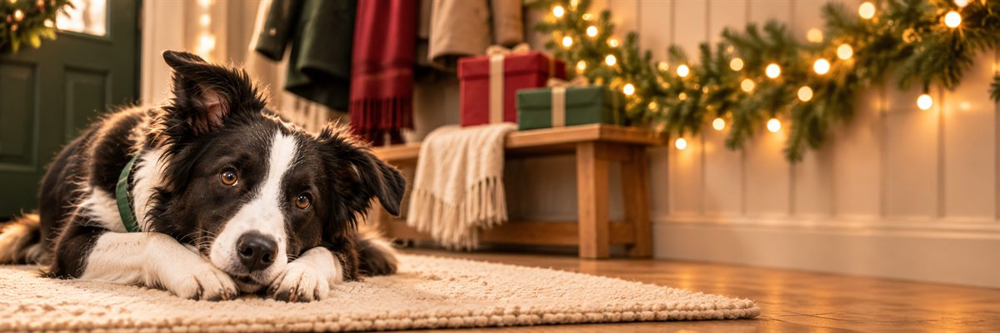

# Email to dog owners 1: Launch

**Send:** Wednesday 25 November 2026  
**Audience:** Dog owners  
**Image:** email-banner (top of the email)  

**Subject line:** A festive treat for your dog this Christmas  
**Preview text:** Get a free sample of Brackenfold Settle, made for Christmas Day.

---

Hello,

Christmas is nearly here.

The house fills up. The doorbell rings. There are new smells, new faces and a lot going on.

Your dog is part of all of it. So this year, we made something just for them.

**Brackenfold Settle is a festive treat made for your dog, so you can both enjoy Christmas Day.**

We would love your dog to try it. So we are giving away free samples this Christmas.

**[Get your free sample]**

### How it works

- Tell us where to send it.
- We post a free sample to your door.
- Your dog gets an early Christmas present.

Free samples are for UK homes only. Sign-ups close on Sunday 20 December 2026, or sooner if samples run out.

Warm wishes,

The Brackenfold team

---

*Brackenfold Pet Health. You are getting this email because you signed up for news from us. [Unsubscribe]*

Portfolio project by Naiomi Wright. Brackenfold Settle is a made-up product.
