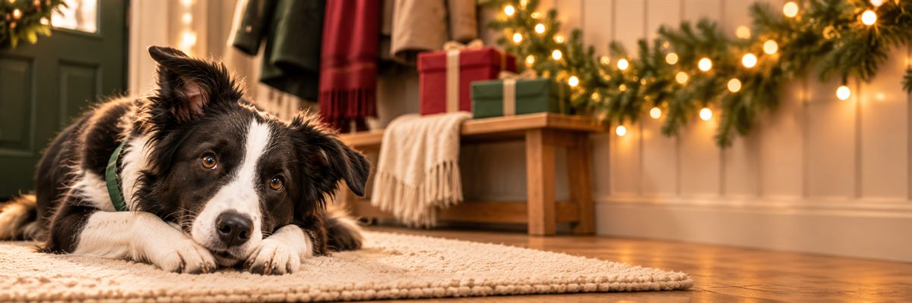

# Email to dog owners 2: Reminder

**Send:** Thursday 3 December 2026  
**Audience:** Dog owners  
**Image:** email-banner (top of the email)  

**Subject line:** Planning Christmas Day with your dog in mind  
**Preview text:** A few simple ideas, and a free festive treat if you have not claimed yours yet.

---

Hello,

Christmas Day is about three weeks away. Now is a good time to plan it with your dog in mind.

Here are a few simple ideas.

- **Give them a quiet spot.** A bed or blanket away from the busiest room, where they can go when they want to.
- **Keep their routine.** Walks and mealtimes at the usual times help the day feel familiar.
- **Keep festive food out of reach.** Chocolate, grapes, raisins, mince pies and Christmas pudding are not safe for dogs. Ask visitors not to share from their plates.
- **Plan their present.** Something that is just for them, to enjoy on the day.

That last one is where we come in.

**Brackenfold Settle is a festive treat made for your dog, so you can both enjoy Christmas Day.**

If you have not claimed your free sample yet, there is still time.

**[Get your free sample]**

Free samples are for UK homes only. Sign-ups close on Sunday 20 December 2026, or sooner if samples run out.

Warm wishes,

The Brackenfold team

---

*Brackenfold Pet Health. You are getting this email because you signed up for news from us. [Unsubscribe]*

Portfolio project by Naiomi Wright. Brackenfold Settle is a made-up product.
