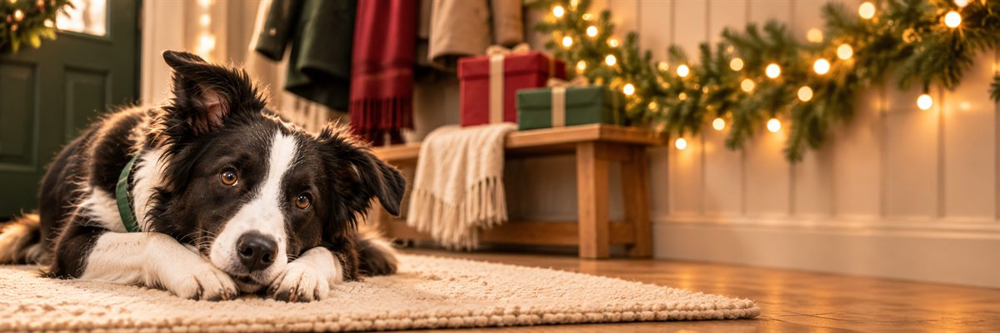

# Email to dog owners 3: Last chance

**Send:** Tuesday 15 December 2026  
**Audience:** Dog owners  
**Image:** email-banner (top of the email)  

**Subject line:** Last chance: a free Christmas treat for your dog  
**Preview text:** Free samples of Brackenfold Settle close on Sunday.

---

Hello,

This is a short one.

Our free samples of Brackenfold Settle close on **Sunday 20 December 2026**.

**Brackenfold Settle is a festive treat made for your dog, so you can both enjoy Christmas Day.**

If you would like one for your dog, now is the time.

**[Get your free sample]**

The sooner you sign up, the better the chance it reaches you before Christmas.

Free samples are for UK homes only, and only while they last.

Thank you for having us in your inbox this Christmas. We hope you and your dog have a lovely one.

Warm wishes,

The Brackenfold team

---

*Brackenfold Pet Health. You are getting this email because you signed up for news from us. [Unsubscribe]*

Portfolio project by Naiomi Wright. Brackenfold Settle is a made-up product.
